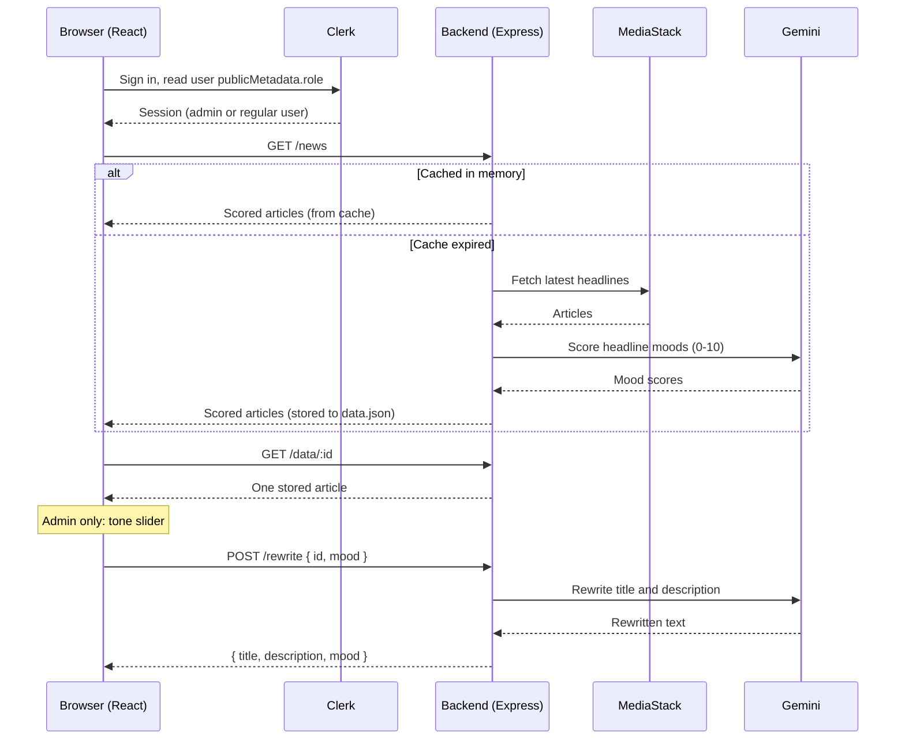

# Harmony Headlines

A React news reader for stories about the Israel-Palestine conflict. Each headline gets an AI "mood" score showing how emotionally charged it is, and an admin can rewrite a story's tone on a 1-10 scale while keeping the facts.

<!-- Screenshot placeholder: add a screenshot of the dashboard and article page here, e.g.

-->

> A hosted deployment exists. It will be restored once the backend has been redeployed with the new server-side integrations.

## Problem and Solution

**Problem.** Conflict news is often written to provoke. Readers can't easily tell how charged a headline is, and they have no way to read the same facts in a calmer framing.

**Solution.** Harmony Headlines shows recent articles with a 0-10 mood score on each card (0 is the most friendly and empathetic, 10 the most aggressive). On the article page, an admin picks a target mood and gets the title and description rewritten by Google Gemini to match it.

## Features

- **News feed.** Up to 10 recent English articles matching `israel,palestine` from US, Israeli and UAE sources, through the [MediaStack API](https://mediastack.com/).
- **Mood scoring.** Every headline is scored 0-10 by Gemini. The score appears on each news card.
- **Article page.** `/article/:id` shows the image, title, description, author, publish date and mood.
- **Tone rewriting (admin only).** A 1-10 slider and an **Update** button send the article to the backend, and Gemini rewrites it to the chosen tone.
- **Authentication.** Sign-in and a user menu are handled by [Clerk](https://clerk.com/). A user counts as an admin when their Clerk `publicMetadata.role` is `"admin"`.
- **Graceful empty state.** If the backend can't return news, the dashboard shows a "News is unavailable right now" message and doesn't crash.

## Tech Stack

| Area | Technology |
| --- | --- |
| UI | React 18 |
| Build tool | Vite 6 |
| Routing and data loading | React Router 7 (`createBrowserRouter`, route `loader`) |
| Authentication | Clerk (`@clerk/clerk-react`) |
| API client | Native `fetch`, wrapped in `src/components/data.js` |
| Styling | Plain CSS, one stylesheet per component |
| Linting | ESLint 9 with React, React Hooks and React Refresh plugins |
| Backend | [Harmony-Headlines-Backend](https://github.com/wardkadan1/Harmony-Headlines-Backend) (Express, MediaStack, Gemini) |

## Architecture

The browser talks only to the backend. The backend calls MediaStack and Gemini, so the third-party API keys stay on the server. Clerk runs on its own in the browser and decides whether the admin controls are shown.



## Security Design

- **Secret keys live on the server.** Vite inlines every `VITE_` variable into the JavaScript bundle, so any key the browser uses can be read by anyone. Earlier versions called MediaStack and Gemini from the browser and exposed both keys this way. All of those calls now go through the backend, and a scan of the production bundle finds no API keys.
- **Only public values reach the client.** The frontend needs just two settings: the Clerk publishable key, which Clerk designs to be public, and the backend URL.
- **Quota protection is server-side.** The backend caches `/news` and rate-limits `/rewrite` per IP, so a single visitor can't drain the MediaStack or Gemini quota.
- **Known limitation: the admin check runs only in the UI.** The tone slider is hidden from non-admins in React, but the backend's `POST /rewrite` doesn't verify a Clerk session. A user who calls the API directly can still request rewrites, within the rate limit. The fix is to send the Clerk session token and verify the admin role on the server.

## Getting Started

### Prerequisites

- Node.js and npm
- A [Clerk](https://clerk.com/) application (publishable key)
- A running [Harmony-Headlines-Backend](https://github.com/wardkadan1/Harmony-Headlines-Backend), local or hosted

### Setup

```bash
git clone https://github.com/wardkadan1/Harmony-Headlines.git
cd Harmony-Headlines
npm install
cp .env.example .env
```

Fill in `.env`:

| Variable | Required | Description |
| --- | --- | --- |
| `VITE_CLERK_PUBLISHABLE_KEY` | Yes | Clerk publishable key. The app throws `Missing Publishable Key` at startup without it. |
| `VITE_API_BASE_URL` | No | Backend base URL, such as `http://localhost:3000`. If unset, it defaults to `https://harmony-headlines-backend.onrender.com`. |

### Scripts

| Command | Description |
| --- | --- |
| `npm run dev` | Start the Vite dev server (http://localhost:5173 by default) |
| `npm run build` | Build for production into `dist/` |
| `npm run preview` | Serve the production build locally |
| `npm run lint` | Run ESLint |

## Project Structure

```
Harmony-Headlines/
├── index.html
├── vite.config.js
├── eslint.config.js
├── .env.example
├── public/
└── src/
    ├── main.jsx            # Entry point, wraps the app in ClerkProvider
    ├── App.jsx             # Routes: "/" (dashboard) and "/article/:id"
    ├── App.css             # Global styles
    └── components/
        ├── data.js         # Backend client: getScoredNews, getArticle, changeMood
        ├── Layout.jsx      # Header with Clerk sign-in and user button
        ├── Dashbord.jsx    # Dashboard page and route loader (GET /news)
        ├── New.jsx         # News card linking to the article page
        ├── Article.jsx     # Article page, admin-only mood slider (POST /rewrite)
        └── *.css           # Per-component styles
```

## Related Repository

- **Backend:** [Harmony-Headlines-Backend](https://github.com/wardkadan1/Harmony-Headlines-Backend). An Express API that fetches news, scores moods and rewrites tone with Gemini, and keeps the API keys on the server.

## Author

**Ward Keadan**

- GitHub: [@wardkadan1](https://github.com/wardkadan1)
- Portfolio: [wardkeadan.vercel.app](https://wardkeadan.vercel.app)
